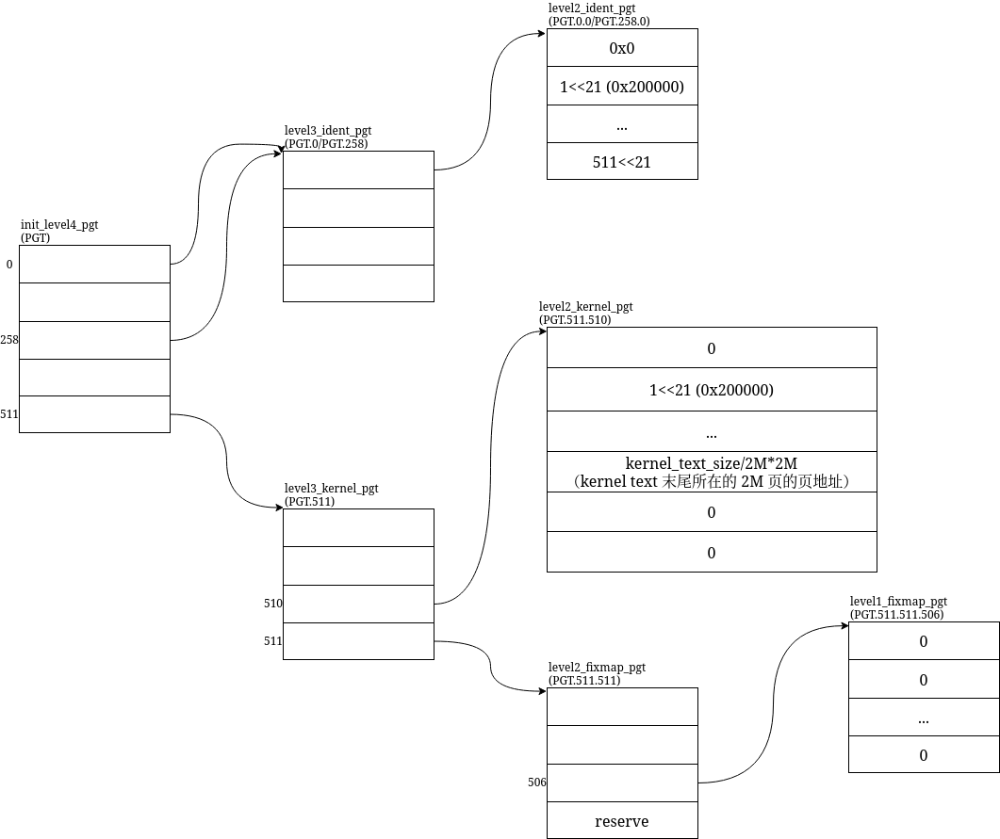

## Introduction
在探究[多核启动](../smp/_index.md)的过程中，我们知道了第二个 CPU 的 Per CPU Data 都是由第一个 CPU 准备好，甚至于启动的汇编代码 trampoline 都是由第一个 CPU 准备的。那第一个 CPU (Bootstrap Process, BSP)呢？它是怎么启动的？从函数调用栈来看，第一个 CPU 的启动位置是 `x86_64_start_kernel`，那它之前又是谁？本文主要探究的便是 BSP CPU 在 `x86_64_start_kernel` 之前的代码。

## Notations

| notation       | what                      | where                                      |
|----------------|---------------------------|--------------------------------------------|
| vmlinux        | Linux 的 elf 文件         | vmlinux                                    |
| vmlinux.bin    | vmlinux 去除 elf 包裹     | arch/x86/boot/compressed/vmlinux.bin       |
| vmlinux.bin.gz | vmlinux.bin 的 gz 压缩    | arch/x86/boot/compressed/vmlinux.bin.gz    |
| vmlinux.w      | vmlinux.bin.gz + 解压代码 | arch/x86/boot/compressed/vmlinux           |
| vmlinux.w.bin  | vmlinux.w 去除 elf 包裹   | arch/x86/boot/vmlinux.bin                  |
| bzImage        | vmlinux.w.bin + setup.bin | arch/x86/boot/bzImage; /boot/vmlinuz-linux |

* setup.bin 是 Linux 自身的引导程序

## TL;DR;
* 在上电
    * 内存和 ROM 会被连接导通，将该地址的内存初始化成 ROM 中烧写好的代码
    * CPU 会将 instructor pointer 设置为 `0xfff0`，然后开始执行
* ROM (`0xfff0`)
    * ROM 读取硬盘的第一个扇区（MBR）中的数据到 `0x7c00`，这正是 GRUB `stage1` 的 MBR 代码
    * 跳转到 `0x7c00` (`stage1/stage1.S`: `_start`)
* GRUB `stage1` (`0x7c00`)
    * 将 `stage2` 搬到了 `0x8200`
    * 并跳转到 `0x8200`(`stage2/asm.S`: `_start`)
* GRUB `stage2` (`0x8200`)
    * `stage2` 会去读取 `grub.cfg`，并显示在屏幕上，供用户修改
    * 读取 `bzImage` 的参数信息，将 `bzImage` 搬到指定位置的内存
        * `vmlinux.w.bin`: `0x100000`
        * `setup.bin`: `0x90000`
    * 配置 Linux 启动参数，并修改 Linux 中参数段的指针
    * `big_linux_boot` 跳转到 `bzImage` 指定的位置 `0x90200` (`arch/x86/boot/header.S`: `_start`，0x200 跳过了 MBR code)
* `bzImage` 的 `boot/vmlinux` (被 grub 拆分到了两处)
    * 把自己搬运到高位
    * 解压 `vmlinux` 到特定位置 `0x200000`
    * 跳转到 `0x200000` (`arch/x86/kernel/head_64.S`: `startup_64`)
* `bzImage` 的 `kernel/vmlinux` (`0x200000`)
    * 启用两张页表
    * `secondary_startup_64`，从低地址跳到高地址。
    * `x86_64_start_kernel`
    * `start_kernel`

## The Big Picture of `bzImage`

```
bzImage
 ├── setup.bin
 │    ├── boot/header.S
 │    │    ├── ...
 │    │    ├── (setup_sectors - 1)
 │    │    ├── ...
 │    │    ├── (sizeof vmlinux.w.bin)
 │    │    ├── ...
 │    │    ├── (root_dev_minor)
 │    │    ├── (root_dev_major)
 │    │    └── ...
 │    └── ...
 └── vmlinux.w.bin
    ├── boot/compressed/head_64.S
    ├── vmlinux.bin.gz
    └── boot/compressed/misc_64.c (gzip decompress code)
```

* `setup_sectors - 1` 的 1 是 MBR

## BIOS
BIOS 会将磁盘的 MBR 复制到 0x7c00 位置，然后跳转执行。

## `grub-legacy`

```c
// stage2
run_script()
  root_func()
  kernel_func()
    load_image()
  initrd_func()
  savedefault_func()
  boot_func()
    big_linux_boot()
```

### `load_image()`

```c
// bzImage
#define LINUX_BZIMAGE_ADDR		RAW_ADDR (0x100000)
// CMD Line
#define LINUX_CL_OFFSET			0x9000
#define LINUX_CL_END_OFFSET		0x90FF


#define MULTIBOOT_SEARCH		8192
  unsigned char buffer[MULTIBOOT_SEARCH];
  grub_open (kernel);
  grub_read (buffer, MULTIBOOT_SEARCH)

  // buffer 判断启动设备
  // case: boot_type is Linux

  data_len = setup_sects << 9;
  //filemax 是在 grub_read 时由文件系统给出，是当前文件大小，这里是 bzImage 的大小
  text_len = filemax - data_len - SECTOR_SIZE;

  linux_data_tmp_addr = (char *) LINUX_BZIMAGE_ADDR + text_len;

  /* 拷贝 setup */
  grub_memmove (linux_data_tmp_addr, buffer, MULTIBOOT_SEARCH);
  grub_read (linux_data_tmp_addr + MULTIBOOT_SEARCH,
             data_len + SECTOR_SIZE - MULTIBOOT_SEARCH);

  /* 内核启动参数拷贝，特别处理了 mem= 参数  */
  char *src = skip_to (0, arg);
  char *dest = linux_data_tmp_addr + LINUX_CL_OFFSET;
  while (dest < linux_data_tmp_addr + LINUX_CL_END_OFFSET && *src)
    *(dest++) = *(src++);

  /* 拷贝 bzImage */
  grub_seek (data_len + SECTOR_SIZE);
  cur_addr = (int) linux_data_tmp_addr + LINUX_SETUP_MOVE_SIZE;
  grub_read ((char *) LINUX_BZIMAGE_ADDR, text_len);
```

* `data_len`： setup_size - mbr_size
* `text_len`： 除 setup 以外的所有

buffer 就是 `bzImage` 前的 8192 字节（`MULTIBOOT_SEARCH`），直接读出来的，放在随便一个地方的(grub 的栈内存上)，这里才是拷入真正的位置 `linux_data_tmp_addr`。由于 buffer 只有 8192 个字节（16个 sector）所以这里做的先把开头的 8192 个字节移入（`grub_memmove`），再把剩下的文件 read （`grub_read`）出来。这里 read 的是 setup。

----

所以前面空出来的 `text_len` 用于放 kernel，也就是说，bzImage 中：

```
+---------------+
| \0            |
+---------------+ ← 0x3af077 (linux_data_tmp_addr+LINUX_CL_END_OFFSET)(0x3a5f78+0x90FF)
| cmdline       |
+---------------+ ← 0x3aef78 (linux_data_tmp_addr+LINUX_CL_OFFSET)(0x3a5f78+0x9000)

+---------------+ ← 0x3a8978 (linux_data_tmp_addr+setup_size)
| setup.bin     |
+---------------+ ← 0x3a5f78 linux_data_tmp_addr (LINUX_BZIMAGE_ADDR + text_len)
| vmlinux.w.bin |
+---------------+ ← 0x100000 LINUX_BZIMAGE_ADDR

* setup.bin 中的部分字段被 build 改了，并且 padding 了
* cmdline 实际会比 LINUX_CL_END_OFFSET 小，\0 也会更前，这里表示的是 cmdline 最长的情况
```


### `big_linux_boot`
接下来，我们要将 real part 移动到 `0x90000`

> 内核启动协议的强制要求：根据 Linux 的 x86 启动协议，对于 2.01 及更早版本的协议，或者 zImage 格式的内核，实模式代码必须加载到 0x90000 处。即使对于稍新的 2.00/2.01 协议，允许加载到别处，内核代码也会在内部将自己重定位到 0x90000。这是内核与引导程序之间一份“古老的契约”。
>
> 抛开历史设计，从纯粹的 x86 实模式技术角度看，0x90000 几乎是当时唯一可行的选择。
>
> 在 16 位实模式下，CPU 的寻址能力被限制在 1MB 以内，而这 1MB 空间的布局非常拥挤且“危险”：
> * 低端内存 (0x00000 - 0x7FFFF)：被中断向量表、BIOS 数据区、以及 DOS 等程序占用，无法保证有连续的大块空间。
> * 高端内存 (0xA0000 - 0xFFFFF)：被显存 (0xA0000) 和 BIOS ROM (0xF0000) 占据，完全不可用。
> * 0x80000 到 0x9FFFF 的 128KB 区域：在早期的 PC 上，0x90000 附近是唯一一块可以保证未被系统占用、且足以容纳整个 64KB 数据段的连续内存区域。
>
> https://chat.deepseek.com/a/chat/s/0c021a83-ebda-47a0-a22d-52df9bf53311

```c
init_bios_info (void)
{
  /*
   *  Get information from BIOS on installed RAM.
   */

  mbi.mem_lower = get_memsize (0); // 639 KiB
  mbi.mem_upper = get_memsize (1); // 2095996 KiB
  ...
}

#define LINUX_SETUP_MOVE_SIZE		0x9100
#define LINUX_OLD_REAL_MODE_ADDR	RAW_ADDR (0x90000)
load_image(){
	  /* Put the real mode part at as a high location as possible.  */
	  linux_data_real_addr
	    = (char *) ((mbi.mem_lower << 10) - LINUX_SETUP_MOVE_SIZE);
	  /* But it must not exceed the traditional area.  */
	  if (linux_data_real_addr > (char *) LINUX_OLD_REAL_MODE_ADDR)
	    linux_data_real_addr = (char *) LINUX_OLD_REAL_MODE_ADDR;
}
```

* `mbi.mem_lower`: [conventional memory](./conventional_memory)

```asm
ENTRY(big_linux_boot)
	movl	EXT_C(linux_data_real_addr), %ebx
	
	/* copy the real mode part */
	movl	EXT_C(linux_data_tmp_addr), %esi
	movl	%ebx, %edi
	movl	$LINUX_SETUP_MOVE_SIZE, %ecx
	cld
	rep
	movsb

	/* change %ebx to the segment address */
	shrl	$4, %ebx                                                // 0x90000 >> 4 = 0x9000
	movl	%ebx, %eax
	addl	$0x20, %eax                                             // 启动段后 0x20 << 4 = 512
	movl	%eax, linux_setup_seg                                   // 0x9020
			                                                        //  |
	/* XXX new stack pointer in safe area for calling functions */  //  |
	movl	$0x4000, %esp                                           //  |
	call	EXT_C(stop_floppy)                                      //  |
                                                                    //  |
	/* final setup for linux boot */                                //  |
                                                                    //  |
	call	EXT_C(prot_to_real)                                     //  |
	.code16                                                         //  |
                                                                    //  |
	/* final setup for linux boot */                                //  |
	cli                                                             //  | 这里需要手动设置地址断点，否则会跳过
	movw	%bx, %ss                                                //  |
	movw	$LINUX_SETUP_STACK, %sp                                 //  |
	                                                                //  |
	movw	%bx, %ds                                                //  |
	movw	%bx, %es                                                //  |
	movw	%bx, %fs                                                //  |
	movw	%bx, %gs                                                //  |
                                                                    //  |
	/* jump to start */                                             //  |
	/* ljmp */                                                      //  |
	.byte	0xea                                                    //  |
	.word	0                                                       //  |
linux_setup_seg:	                                                // <-
	.word	0
	.code32
```

> rep movsb: A fast hardware loop that copies bytes from %esi to %edi, decrementing %ecx until it hits 0. This moves the Linux setup code into its final home.

`0xea` 是 ljmp 的 opcode。

> Because the assembler (like GNU as) can sometimes miscalculate the target address or syntax for a far jump across different segments, early bootloader developers wrote the raw bytes manually to guarantee the correct instruction structure.

而 `linux_setup_seg` 在上面被改了，gdb 最终给出的结果是 ljmp 到该地址

```
ljmp   $0x9020,$0x0
# 0x9020 << 16 + 0x0 = 0x90200
```

拷贝后的内存布局

```
+---------------+
| \0            |
+---------------+ ← 0x3af077 (linux_data_tmp_addr+LINUX_CL_END_OFFSET)(0x3a5f78+0x90FF)
| cmdline       |
+---------------+ ← 0x3aef78 (linux_data_tmp_addr+LINUX_CL_OFFSET)(0x3a5f78+0x9000)

+---------------+ ← 0x3a8978 (linux_data_tmp_addr+setup_size)
| setup.bin     |
+---------------+ ← 0x3a5f78 linux_data_tmp_addr (LINUX_BZIMAGE_ADDR + text_len)
| vmlinux.w.bin |
+---------------+ ← 0x100000 LINUX_BZIMAGE_ADDR

* 拷贝 real part 到低位：

+---------------+ ← 0x099100 (LINUX_OLD_REAL_MODE_ADDR + LINUX_SETUP_MOVE_SIZE)(0x090000 + 0x9100)
| \0            |
+---------------+ ← 0x0990ff (LINUX_OLD_REAL_MODE_ADDR + LINUX_CL_END_OFFSET)(0x090000 + 0x90FF)
| cmdline       |
+---------------+
| ???????       |
+---------------+ ← 0x092a00 (LINUX_OLD_REAL_MODE_ADDR + setup_size)
| setup.bin     |
+---------------+ ← 0x090000 LINUX_OLD_REAL_MODE_ADDR

* LINUX_SETUP_MOVE_SIZE = LINUX_CL_END_OFFSET + 1

* real part 的 cmdline 的起始位置是 0x090000+0x9000
```

最终 `jmp` 的位置是 `0x90200` 跳过了 `bzImage` 开头的 MBR 那 512 字节


## `bzImage`

The Big Picture

```
bzImage
 ├── setup.bin
 │    ├── boot/header.S
 │    │    ├── ...
 │    │    ├── (setup_sectors - 1)
 │    │    ├── ...
 │    │    ├── (sizeof vmlinux.w.bin)
 │    │    ├── ...
 │    │    ├── (root_dev_minor)
 │    │    ├── (root_dev_major)
 │    │    └── ...
 │    └── ...
 └── vmlinux.w.bin
    ├── boot/compressed/head_64.S
    ├── vmlinux.bin.gz
    └── boot/compressed/misc_64.c (gzip decompress code)
```

* `setup_sectors - 1` 1 是 MBR

通过 `.bzImage.cmd` 我们可以知道，`bzImage` 是由 `arch/x86/boot/tools/build.c` 构造的

```c
static void usage(void)
{
	die("Usage: build [-b] setup system [rootdev] [> image]");
}
```

* setup 就是 `setup.bin`
* system 就是 `vmlinux.w.bin`

`bzImage` 开头的 MBR 是落在了 `setup.bin` 中。

### `setup.bin`
前面我们说了很多次 MBR，都说要跳过，在跳过 512 字节、继续启动流程之前，我们先

1. 看看 setup.bin 是如何构造的
2. 看看这 512 字节到底是什么

#### `setup.bin` 的结构
通过 `Makefile` 我们可以看到 `setup.bin` 是如何构造的：

```
# setup.o
setup-y		+= a20.o apm.o cmdline.o copy.o cpu.o cpucheck.o edd.o
setup-y		+= header.o main.o mca.o memory.o pm.o pmjump.o
setup-y		+= printf.o string.o tty.o video.o version.o voyager.o
...
targets		+= $(setup-y)

# setup.elf
LDFLAGS_setup.elf	:= -T
$(obj)/setup.elf: $(src)/setup.ld $(SETUP_OBJS) FORCE
	$(call if_changed,ld)

# setup.bin
OBJCOPYFLAGS_setup.bin	:= -O binary
$(obj)/setup.bin: $(obj)/setup.elf FORCE
	$(call if_changed,objcopy)
```

`setup.elf` 会依照 `setup.ld` 中的内存分布来放对应的符号。

```ld
# setup.ld
ENTRY(_start)
SECTIONS
{
	. = 0;
	.bstext		: { *(.bstext) }
	.bsdata		: { *(.bsdata) }

	. = 497;
	.header		: { *(.header) }
	.inittext	: { *(.inittext) }
	.initdata	: { *(.initdata) }
	.text		: { *(.text*) }

	. = ALIGN(16);
	.rodata		: { *(.rodata*) }
    ...
}
```

我们会看到 `.bstext` 和 `.bsdata` 正是 `header.S` 中的各个 section

```asm
// grep -F .section arch/x86/boot/header.S
	.section ".bstext", "ax"
	.section ".bsdata", "a"
	.section ".header", "a"
	.section ".inittext", "ax"
	.section ".initdata", "a"
```


`readelf` 也可以印证链接的结果

```
readelf -a setup.elf

  [Nr] Name              Type            Addr     Off    Size   ES Flg Lk Inf Al
  [ 0]                   NULL            00000000 000000 000000 00      0   0  0
  [ 1] .bstext           PROGBITS        00000000 001000 00002d 00  AX  0   0  1
  [ 2] .bsdata           PROGBITS        0000002d 00102d 000090 00   A  0   0  1
  [ 3] .header           PROGBITS        000001f1 0011f1 000057 00   A  0   0  1
  [ 4] .inittext         PROGBITS        00000248 001248 0000c2 00  AX  0   0  1
  [ 5] .initdata         PROGBITS        0000030a 00130a 00001e 00   A  0   0  1
  [ 6] .text             PROGBITS        00000328 001328 0025ff 00  AX  0   0  4
```

> 第一个 section 的 .bstext 的 Addr 是 0，但 off 是 0x1000，Addr 和 Off 有什么区别？Off 是在 ELF 中的偏移，也就是说，真正的 .bstext 不是在 elf 的开头，elf 有头，头长位 0x1000。我们通过 xxd 读取，就会发现：elf 的 0x1000 处的 bytes 正是 bin 的开头位置，也就是 bin 去掉了 elf 的包裹格式，就是纯的裸代码。
> by LLM

##### entry point of setup.elf
在 `setup.ld` 中有一个 `ENTRY(_start)`，指定了这个 elf 的入口函数地址，而这个 `_start` 正是 `header.S` 中的 `_start`，这个`_start` 在哪里？

对照 section 表，我们可以看到 0x200 的 address 对应的是在 .header 中，

```asm
	.section ".header", "a"
	.globl	hdr
hdr:
setup_sects:	.byte SETUPSECTS
root_flags:	.word ROOT_RDONLY
syssize:	.long SYSSIZE
ram_size:	.word RAMDISK
vid_mode:	.word SVGA_MODE
root_dev:	.word ROOT_DEV
boot_flag:	.word 0xAA55

	# offset 512, entry point

	.globl	_start
_start:
		# Explicitly enter this as bytes, or the assembler
		# tries to generate a 3-byte jump here, which causes
		# everything else to push off to the wrong offset.
		.byte	0xeb		# short (2-byte) jump
		.byte	start_of_setup-1f
```

.header section 是在 header.S 中，由于这段代码是 `.code16`，`.word` 对应的是 16bits，而 `.long` 始终都是 32bit，所以，.start 相较于 .header section 的偏移是 15 (1+2+4+2*4) bytes。

而在 `setup.ld` 中，我们是将 .header 放到了 setup 开头 `497` bytes 的偏移位置

所以 `.start` 的偏移是 512 bytes 正是 0x200，也正是 MBR 后的第一个sector。


我们可以通过 `readelf -a setup.elf` 得到验证：

```
Entry point address:               0x200
```

另外，这里我们也能看到很多被 `arch/x86/boot/tools/build.c` 填入的字段。

#### 和 Bootloader 的接口
除此之外我们还能看到很多和 Bootloader 的接口，譬如 `ramdisk_image` 记录了 `initrd` 被 bootloader 加载的位置，这些字段会被 bootloader 修改，从而后续内核可以从正确的位置读取，

* 写，grub 的 `load_image`：`lh->cmd_line_ptr = linux_data_real_addr + LINUX_CL_OFFSET;`
* 读，`_start`：`memcpy(&boot_params.hdr, &hdr, sizeof hdr);`

这些接口被定义在 `Documentation/i386/boot.txt`

```asm
code32_start:				# here loaders can put a different
					# start address for 32-bit code.
#ifndef __BIG_KERNEL__
		.long	0x1000		#   0x1000 = default for zImage
#else
		.long	0x100000	# 0x100000 = default for big kernel
#endif

ramdisk_image:	.long	0		# address of loaded ramdisk image
					# Here the loader puts the 32-bit
					# address where it loaded the image.
					# This only will be read by the kernel.

ramdisk_size:	.long	0		# its size in bytes
// ...
cmd_line_ptr:	.long	0		# (Header version 0x0202 or later)
					# If nonzero, a 32-bit pointer
					# to the kernel command line.
					# The command line should be
					# located between the start of
					# setup and the end of low
					# memory (0xa0000), or it may
					# get overwritten before it
					# gets read.  If this field is
					# used, there is no longer
					# anything magical about the
					# 0x90000 segment; the setup
					# can be located anywhere in
					# low memory 0x10000 or higher.
```

#### `bootsect_start` @offset=0
代码很清晰明了，主要就是将以下的 `bugger_off_msg` 显示出来，然后等待用户输入，重启。我们可以直接用 `qemu-system-x86_64 bzImage` 直接来验证一下。


```asm
bugger_off_msg:
	.ascii	"Direct booting from floppy is no longer supported.\r\n"
	.ascii	"Please use a boot loader program instead.\r\n"
	.ascii	"\n"
	.ascii	"Remove disk and press any key to reboot . . .\r\n"
	.byte	0
```

#### `_start` @offset=512
这里是 `bzImage` 真正的入口，正是在 GRUB 的 `big_linux_boot` 中跳转的位置

```c
// arch/x86/boot/header.S
_start();
  start_of_setup();
    main(); // arch/x86/boot/main.c
      copy_boot_params();
        memcpy(&boot_params.hdr, &hdr, sizeof hdr); // &hdr 是 header.S 中被 bootloader 修改过的 hdr 记录了各种信息所在
      validate_cpu(); // arch/x86/boot/cpu.c
      go_to_protected_mode(); // arch/x86/boot/pm.c
        protected_mode_jump(boot_params.hdr.code32_start, (u32)&boot_params + (ds() << 4));
```

```
(gdb) p/x boot_params.hdr.code32_start
$9 = 0x100000
```

```
protected_mode_jump
	movl	%edx, %esi		# Pointer to boot_params table
	movl	%eax, 2f		# Patch ljmpl instruction

    // ...

	# Jump to the 32-bit entrypoint
	.byte	0x66, 0xea		# ljmpl opcode
2:	.long	0			# offset
	.word	__BOOT_CS		# segment

	.size	protected_mode_jump, .-protected_mode_jump
```

在做了一系列的准备工作之后，准备好启动参数 `boot_params`(存于 `%esi`，这个 `%esi` 最终会被 `vmlinux.bin` 拷贝到 `%edi`，作为 `x86_64_start_kernel` 的 `real_mode_data` 参数)。然后 `setup.bin` 便跳转到了 `0x100000`，这是 `vmlinux.w.bin` 的第 0 个字节，是由 grub 加载的。

回顾一下，目前大致有用的内存如下

```
+---------------+ ← 0x3a8978 (linux_data_tmp_addr+setup_size)
| setup.bin     |
+---------------+ ← 0x3a5f78 linux_data_tmp_addr (LINUX_BZIMAGE_ADDR + text_len)
| vmlinux.w.bin |
+---------------+ ← 0x100000 LINUX_BZIMAGE_ADDR

+---------------+ ← 0x099100 (LINUX_OLD_REAL_MODE_ADDR + LINUX_SETUP_MOVE_SIZE)(0x090000 + 0x9100)
| \0            |
+---------------+ ← 0x0990ff (LINUX_OLD_REAL_MODE_ADDR + LINUX_CL_END_OFFSET)(0x090000 + 0x90FF)
| cmdline       |
+---------------+ ← 0x0990ff (LINUX_OLD_REAL_MODE_ADDR + LINUX_CL_END_OFFSET)(0x090000 + 0x90FF)
```

`cmdline` 的位置由 `boot_params` 记录

```
(gdb) p/x ((struct boot_params *) $esi)->hdr->cmd_line_ptr
$18 = 0x99000
(gdb) x/s ((struct boot_params *) $esi)->hdr->cmd_line_ptr
0x99000:        "root=/dev/sda2 ro console=ttyS0 nokaslr"
```


### `vmlinux.w.bin`
`vmlinux.w.bin` 主要做的就是解压。

#### `boot/compressed/head_64.S`
##### stack and heap
stack 高往低，heap 低往高

在 `head_64.S` 的最末尾有一个初始化为 0 的 4K 的 user_stack。

```asm
// compressed/head_64.S
.section ".text"
relocated:
	/* Setup the stack */
	leaq	user_stack_end(%rip), %rsp
	call	decompress_kernel

user_stack:
	.fill 4096,4,0
user_stack_end:
// end of section .text
```

而从链接脚本中我们可以看到在整个文件的末尾有 6*4K 的页表预留区域和堆区，他们都只是预留，并未初始化。

* 1 页 PGD
* 1 页 PUD
* 4 页 PMD

```lds
// compressed/vmlinux_64.lds
SECTIONS
{

	. = 0;
	.text :  { /* ... */ }
	.rodata :{ /* ... */ }
	.data :	 { /* ... */ }
	.bss : {
		_bss = . ;
		*(.bss)
		*(.bss.*)
		*(COMMON)
		. = ALIGN(8);
		_end = . ;
		. = ALIGN(4096);
		pgtable = . ;
		. = . + 4096 * 6;
		_heap = .;
	}
}
```

注意 heap 是从低往高，所以后面海量内存的都可以算作堆区

在 `compressed/misc_64.c`（解压代码） 中 `malloc` 就非常简单

```c
asmlinkage void decompress_kernel(void *rmode, unsigned long heap,
	uch *input_data, unsigned long input_len, uch *output)
{
	free_mem_ptr     = heap;	/* Heap  */
	free_mem_end_ptr = heap + HEAP_SIZE;
}
static void *malloc(int size)
{
	void *p;

	if (size <0) error("Malloc error");
	if (free_mem_ptr <= 0) error("Memory error");

	free_mem_ptr = (free_mem_ptr + 3) & ~3;	/* Align */

	p = (void *)free_mem_ptr;
	free_mem_ptr += size;

	if (free_mem_ptr >= free_mem_end_ptr)
		error("Out of memory");

	return p;
}
```

##### `startup_32` 和临时页表
主要做了：

* 建立内核的直接映射的页表（管理开头的 4GiB 内存）。此时的页表是 va = pa。
* 启用 Long mode

注意这里 CPU 给出的就已经是 va 了，只是 va = pa，所以看起来没什么两样，看起来还在 pa 中执行。

va = pa + 0xffffffff80000000 的映射要等 `vmlinux.bin` 的 `kernel/head_64.S` 中再建立


```asm
// arch/x86/boot/compressed/head_64.S
startup_32:
    // ...
	call verify_cpu
    // ...
/*
 * Prepare for entering 64 bit mode
 */

	/* Load new GDT with the 64bit segments using 32bit descriptor */
	leal	gdt(%ebp), %eax
	movl	%eax, gdt+2(%ebp)
	lgdt	gdt(%ebp)

	/* Enable PAE mode */
	xorl	%eax, %eax
	orl	$(1 << 5), %eax
	movl	%eax, %cr4

 /*
  * Build early 4G boot pagetable
  */
	/* Initialize Page tables to 0*/
	leal	pgtable(%ebx), %edi
	xorl	%eax, %eax
	movl	$((4096*6)/4), %ecx             // stosl 每次写 4 字节
	rep	stosl

	/* Build Level 4 */
	leal	pgtable + 0(%ebx), %edi
	leal	0x1007 (%edi), %eax
	movl	%eax, 0(%edi)                   // 写入 Level 4 的第一个表项
    /*
     * %eax = %edi + 0x1007
     *      = pgtable + 0x1000 + 0x7
     *
     * pgtable + 0x1000 是下一级表 Level 3 的基址。
     * 0x1000=4K
     * 低 12 位 0x007 是页表项标志：
     * bit 0 = P   Present
     * bit 1 = RW  Read/Write
     * bit 2 = US  User/Supervisor，这里置 1 表示 User
     */

	/* Build Level 3 */
	leal	pgtable + 0x1000(%ebx), %edi    // %edi 指向 Level 3 表，地址为 pgtable + 0x1000。
	leal	0x1007(%edi), %eax              // Level 2 的基址
	movl	$4, %ecx
1:	movl	%eax, 0x00(%edi)                // 写到 Level 3 的表项
	addl	$0x00001000, %eax               // Level 2 的下一张表的地址(写到 Level 3 的表项)
	addl	$8, %edi                        // Level 3 中的下一个表项
	decl	%ecx
	jnz	1b                                  // 写了 4 项 (%ecx)

	/* Build Level 2 */
	leal	pgtable + 0x2000(%ebx), %edi
	movl	$0x00000183, %eax
	movl	$2048, %ecx
1:	movl	%eax, 0(%edi)                   // 写到 Level 2 的表项
	addl	$0x00200000, %eax               // 0~2M, 2M~4M,... 的物理地址(写到 Level 2 的表项)
	addl	$8, %edi                        // Level 2 中的下一个表项
	decl	%ecx
	jnz	1b                                  // 写了 2048 项 (%ecx)
    /*
     * 0x183 = 0x100 | 0x80 | 0x3
     * bit 0 = P   Present
     * bit 1 = RW  Read/Write
     * bit 7 = PS  Page Size，置 1 表示 2MB 大页
     * bit 8 = G   Global
     *
     * 虚拟地址 0x00000000 -> 物理地址 0x00000000
     * 虚拟地址 0x00200000 -> 物理地址 0x00200000
     * ...
     * 虚拟地址 0xFFE00000 -> 物理地址 0xFFE00000
     *
     * 2048 = 4(KiB/page)/8(B/address) * 4(page)
     *      = 512(address/page)*4(page)
     *      = 2048(address)
     */

	/* Enable the boot page tables */
	leal	pgtable(%ebx), %eax
	movl	%eax, %cr3

    /*
     * PGD[0] -> PUD
     * PUD[0..3] -> 4 张 PMD
     * PMD0[0..512] PMD1[0..512] PMD2[0..512] PMD3[0..512] 2048 地址，每个地址对应 2MB 大页项 -> 恒等映射 0~4GB
     */

	/* Enable Long mode in EFER (Extended Feature Enable Register) */
    //...

	/* Setup for the jump to 64bit mode
	 *
	 * When the jump is performend we will be in long mode but
	 * in 32bit compatibility mode with EFER.LME = 1, CS.L = 0, CS.D = 1
	 * (and in turn EFER.LMA = 1).	To jump into 64bit mode we use
	 * the new gdt/idt that has __KERNEL_CS with CS.L = 1.
	 * We place all of the values on our mini stack so lret can
	 * used to perform that far jump.
	 */
	pushl	$__KERNEL_CS
	leal	startup_64(%ebp), %eax
	pushl	%eax

	/* Enter paged protected Mode, activating Long Mode */
	movl	$0x80000001, %eax /* Enable Paging and Protected mode */
	movl	%eax, %cr0

	/* Jump from 32bit compatibility mode into 64bit mode. */
	lret

no_longmode:
	/* This isn't an x86-64 CPU so hang */
1:
	hlt
	jmp     1b
```

##### `startup_64`
主要做拷贝 `vmlinux.w.bin` 到高位，然后解压。

由于后续的启动，需要将 `vmlinux.bin` 解压到 `0x200000` 的位置，而这里 `vmlinux.w.bin` 已经占用了这部分的空间，所以需要先将 `vmlinux.w.bin` 复制到后半段


```asm
// arch/x86/boot/compressed/head_64.S
	/* Be careful here startup_64 needs to be at a predictable
	 * address so I can export it in an ELF header.  Bootloaders
	 * should look at the ELF header to find this address, as
	 * it may change in the future.
	 */
	.code64
	.org 0x200
ENTRY(startup_64)
	/* Setup data segments. */
    // ...

	/* Compute the decompressed kernel start address.  It is where
	 * we were loaded at aligned to a 2M boundary. %rbp contains the
	 * decompressed kernel start address.
	 *
	 * If it is a relocatable kernel then decompress and run the kernel
	 * from load address aligned to 2MB addr, otherwise decompress and
	 * run the kernel from CONFIG_PHYSICAL_START
	 */

	/* Start with the delta to where the kernel will run at. */
	movq	$CONFIG_PHYSICAL_START, %rbp # $CONFIG_PHYSICAL_START=0x200000
	movq	%rbp, %rbx

	/* Replace the compressed data size with the uncompressed size */
	movl	input_len(%rip), %eax
	subq	%rax, %rbx
	movl	output_len(%rip), %eax
	addq	%rax, %rbx
	/* input_len: This is a label pointing to the address where the 4-byte size is stored.
	 * input_len(%rip): This fetches the 4-byte content stored at that address using PC-relative addressing.
	 *
	 * $rbx = CONFIG_PHYSICAL_START - $input_len + $output_len
	 *      = CONFIG_PHYSICAL_START + (解压后大小) - （解压前大小）
	 *
	 * $rbx 存的是拷贝压缩的 vmlinux 到的目标地址
	 *
	 * 所以这里的意思是：
	 * 拷贝完成之后，压缩包放在解压区的末尾。虽然解压时可能会覆盖原始的压缩包，
	 * 但那部分大概是已经被解压完成的了。最差的情况是完全没压缩，那么就是从原始位置拷
	 * 贝出来，拷回原始位置。但是又因为我们有 bss，所以最差的情况还是会有 bss 那么大的
	 * 偏移。栈位于 .text 的末尾
	 */

	/* Add 8 bytes for every 32K input block */
	//...
	/* Add 32K + 18 bytes of extra slack and align on a 4K boundary */
	//...
	/* 微调 $rbx
	 * Gemini: 用于 gzip 算法的硬性要求（滑动窗口缓冲区）
	 * https://share.google/aimode/ZNuxp67UMyrvOCwb4
	 */

	/* Copy the compressed kernel to the end of our buffer
	 * where decompression in place becomes safe.
	 */

	leaq	_end(%rip), %r8
	/* $r8 存的是 _end 段的代码地址
	 * lea 对于 rip 是取相对大小，使得目标寄存器存的就是 _end 代码所在的实际地址
	 */
	leaq	_end(%rbx), %r9
	/* $r9 存的是 _end 的值 + rbx
	 * lea 对于 rbx 是取绝对大小（文件中的 offset）
	 */
	movq	$_end /* - $startup_32 */, %rcx
1:	subq	$8, %r8
	subq	$8, %r9
	movq	0(%r8), %rax
	movq	%rax, 0(%r9)
	subq	$8, %rcx
	jnz	1b

    // rcx: vmlinux 的大小+bss，用于计数
    // r8: vmlinux 的大小+bss 的末尾
    // r9: 拷贝目标区域的末尾

/*
 * Jump to the relocated address.
 */
/*
 * rbx 是新区的压缩 vmlinux 的起始位置，起始位置往后 relocated，那就是新区的 relocated
 */
	leaq	relocated(%rbx), %rax
	jmp	*%rax

```

> jnz tag: Jump tag to  when last result is None-Zero

一大段代码，最终影响的是内存中的数据，我们来看一下解压前的内存布局

```
_end = 0x2aa7e8
$rbx = 0x56a000 # rbx 存的是拷贝压缩的 vmlinux 到的目标地址
```

```
拷贝前
$r8 = 0x3aa7e8 # 存的是 _end 段的代码地址
$r9 = 0x8147e8 # 存的是 _end 的值 + rbx 即拷贝后的结尾地址

拷贝后
$r8 = 0x100000
$r9 = 0x56a000
```

拷贝后的内存

```
$rbx = CONFIG_PHYSICAL_START + (output_len - input_len) + extra bytes for gz
$r9 = $rbx + _end
$r8 = CONFIG_PHYSICAL_START + _end

+----------------+ ← 0x8147e8 (CONFIG_PHYSICAL_START + (output_len - input_len) + extra bytes for gz + _end)
| bss            |
+----------------+
| unpack-code    |
+----------------+
| vmlinux.bin.gz |
+----------------+
| startup_64     |
+----------------+
| startup_32     |
+----------------+ ← 0x56a000 (CONFIG_PHYSICAL_START + (output_len - input_len) + extra bytes for gz)

+----------------+ ← 0x3aa7e8 (LINUX_BZIMAGE_ADDR + _end)
| bss            |
+----------------+ ← 0x3a5f78 (LINUX_BZIMAGE_ADDR + vmlinux_size)
| unpack-code    |
+----------------+
| vmlinux.bin.gz |
+----------------+
| startup_64     |
+----------------+
| startup_32     |
+----------------+ ← 0x100000 (LINUX_BZIMAGE_ADDR)

由 grub 拷贝下来的：cmdline

+----------------+ ← 0x099100 (LINUX_OLD_REAL_MODE_ADDR + LINUX_SETUP_MOVE_SIZE)(0x090000 + 0x9100)
| \0             |
+----------------+ ← 0x0990ff (LINUX_OLD_REAL_MODE_ADDR + LINUX_CL_END_OFFSET)(0x090000 + 0x90FF)
| cmdline        |
+----------------+ ← 0x099000
```

##### `relocated`
上一节，我们拷贝了 `vmlinux.w.bin` 到高位，最后跳转到高位的 relocated 处，relocated 做什么：

1. 准备解压环境，由于解压代码是 C，涉及函数调用，内存分配等，不能直接用 jmp 等。所以需要创建堆栈
2. `decompress_kernel` `vmlinux.bin.gz` to `CONFIG_PHYSICAL_START` (0x200000)
3. `jmp` to `CONFIG_PHYSICAL_START` (0x200000)，从 `vmlinux.bin` 的第一个字节开始执行

```asm
.section ".text"
relocated:
	/*
	 * Clear BSS
	 */
	/*
	 * 我们上面拷贝了 bss 区，但是实际上 src 中并没有初始化的 bss 区，所以需要先初始化
	 */
	// ...

	/* Setup the stack */
	leaq	user_stack_end(%rip), %rsp

	/* zero EFLAGS after setting rsp */
	// ...

/*
 * Do the decompression, and jump to the new kernel..
 */
	pushq	%rsi			# Save the real mode argument
	movq	%rsi, %rdi		# real mode address
	leaq	_heap(%rip), %rsi	# _heap
	leaq	input_data(%rip), %rdx  # input_data
	movl	input_len(%rip), %eax
	movq	%rax, %rcx		# input_len
	movq	%rbp, %r8		# output
	call	decompress_kernel
	popq	%rsi


/*
 * Jump to the decompressed kernel.
 */
	jmp	*%rbp # 0x200000
```

relocated 中准备的参数列表：

1. `rdi`: `boot_params`（`real_mode_data`）
2. `rsi`: _heap 区
3. `rdx`: input_data 的内存位置
4. `rcx`: input_len 的内存位置
5. `r8`: 解压位置，也就是 0x200000

#### `boot/compressed/misc_64.c`

##### `decompress_kernel` 和 `vidmem` 显示

```c
asmlinkage void decompress_kernel(void *rmode, unsigned long heap,
	uch *input_data, unsigned long input_len, uch *output)
{
	real_mode = rmode;

	if (RM_SCREEN_INFO.orig_video_mode == 7) {
		vidmem = (char *) 0xb0000;
		vidport = 0x3b4;
	} else {
		vidmem = (char *) 0xb8000;
		vidport = 0x3d4;
	}
	free_mem_ptr     = heap;	/* Heap  */
	free_mem_end_ptr = heap + HEAP_SIZE;
}
```

real_mode 用于 `putstr`  获取光标位置，

1. 在合适的时机 scroll
2. 更新闪烁的光标位置

```c
static void putstr(const char *s)
{
	int x,y,pos;
	char c;

	x = RM_SCREEN_INFO.orig_x;
	y = RM_SCREEN_INFO.orig_y;

	while ( ( c = *s++ ) != '\0' ) {
		if ( c == '\n' ) {
			x = 0;
			if ( ++y >= lines ) {
				scroll();
				y--;
			}
		} else {
			vidmem [ ( x + cols * y ) * 2 ] = c; 
			if ( ++x >= cols ) {
				x = 0;
				if ( ++y >= lines ) {
					scroll();
					y--;
				}
			}
		}
	}

	RM_SCREEN_INFO.orig_x = x;
	RM_SCREEN_INFO.orig_y = y;

	pos = (x + cols * y) * 2;	/* Update cursor position */
	outb_p(14, vidport);
	outb_p(0xff & (pos >> 9), vidport+1);
	outb_p(15, vidport);
	outb_p(0xff & (pos >> 1), vidport+1);
}
```

[字符显示](./display_character.md)


在 `putstr` 时修改 vidmem 可以改变 VNC server 屏幕上的显示


### `vmlinux.bin`
我们从 `vmlinux.w.bin` 的 `relocated`（`compressed/head_64.S`）跳转到了 `vmlinux.bin` 的第一个字节 `0x200000`。

#### `kernel/head_64.S` 和正式页表
汇编部分主要做了：

1. 准备好全新的页表
2. 修复页表项目
2. 准备从 `va=pa` 的页表转成 `va=pa+0xffffffff80000000`
3. 跳转到 `initial_code` ( BSP 是 `x86_64_start_kernel`，AP 是 `start_secondary`，详见 [Linux 中多 CPU 的启动](../smp/_index.md)) 的 C 代码

##### 预填页表

我们在[页表](../page_table/_index.md)一文中介绍了 VA 和 PA 的转换关系。这里我们来实际看看初始化过程中页表和构造。我们现在看的是旧版的内核，此时采用的还是 4 级页表，并没有 `P4D`，但原理都是一样的。

先放一个 64 位的地址：

```
                        pgd                  pmd                  (offset)
                    -----------           -----------           ---------------
1111 1111 1111 1111 1111 1111 1111 1111 1000 0000 0010 0000 0000 0000 0000 0000
-------------------            -----------           -----------
   reserve                        pud                   (pte)
                                                     --------------------------
                                                        offset for 2MiB page
```

我们来仔细看看在 `kernel/head_64.S` 中的页表究竟是怎么样的：

```asm
// include/asm-x86/page_64.h
#define __START_KERNEL_map	_AC(0xffffffff80000000, UL)

// include/asm-x86/pgtable_64.h
#define _PAGE_PRESENT	0x001
#define _PAGE_RW	0x002
#define _PAGE_PWT	0x008
#define _PAGE_PCD	0x010
#define _PAGE_ACCESSED	0x020
#define _PAGE_DIRTY	0x040
// ...
#define _KERNPG_TABLE	(_PAGE_PRESENT | _PAGE_RW | _PAGE_ACCESSED | _PAGE_DIRTY)

/*
 * PMD_SHIFT determines the size of the area a middle-level
 * page table can map
 */
#define PMD_SHIFT	21
/*
 * pte 的数字每 + 1 就涨 4 KiB 那么多，
 * 从按字节编址的角度考虑，不管最后 12位的 offset 的含义。PMD 每增长一个 1 就代表有那么多个 bytes 被映射。同理 PMD 也是
 */
#define PMD_SIZE	(_AC(1,UL) << PMD_SHIFT)

#define __PAGE_KERNEL_EXEC \
	(_PAGE_PRESENT | _PAGE_RW | _PAGE_DIRTY | _PAGE_ACCESSED)
#define __PAGE_KERNEL_LARGE_EXEC \
	(__PAGE_KERNEL_EXEC | _PAGE_PSE)


// arch/x86/kernel/head_64.S
.balign PAGE_SIZE

#define NEXT_PAGE(name) \
	.balign	PAGE_SIZE; \
ENTRY(name)

/* Automate the creation of 1 to 1 mapping pmd entries */
#define PMDS(START, PERM, COUNT)		\
	i = 0 ;					\
	.rept (COUNT) ;				\
	.quad	(START) + (i << 21) + (PERM) ;	\
	i = i + 1 ;				\
	.endr

	/*
	 * This default setting generates an ident mapping at address 0x100000
	 * and a mapping for the kernel that precisely maps virtual address
	 * 0xffffffff80000000 to physical address 0x000000. (always using
	 * 2Mbyte large pages provided by PAE mode)
	 */
NEXT_PAGE(init_level4_pgt)
	.quad	level3_ident_pgt - __START_KERNEL_map + _KERNPG_TABLE  // Entry       0:     8 bytes
	.fill	257,8,0                                                // Entry   1-257: 257*8 bytes
	.quad	level3_ident_pgt - __START_KERNEL_map + _KERNPG_TABLE  // Entry     258:     8 bytes
	.fill	252,8,0                                                // Entry 259-510: 252*8 bytes
	/* (2^48-(2*1024*1024*1024))/(2^39) = 511 */
	.quad	level3_kernel_pgt - __START_KERNEL_map + _PAGE_TABLE   // Entry 511: 8 bytes

NEXT_PAGE(level3_ident_pgt)
	.quad	level2_ident_pgt - __START_KERNEL_map + _KERNPG_TABLE
	.fill	511,8,0

NEXT_PAGE(level3_kernel_pgt)
	.fill	510,8,0
	/* (2^48-(2*1024*1024*1024)-((2^39)*511))/(2^30) = 510 */
	.quad	level2_kernel_pgt - __START_KERNEL_map + _KERNPG_TABLE
	.quad	level2_fixmap_pgt - __START_KERNEL_map + _PAGE_TABLE
    /*
     * PGD.511.510: level2_kernel_pgt
     * PGD.511.511: level2_fixmap_pgt
     */

NEXT_PAGE(level2_fixmap_pgt)
	.fill	506,8,0
	.quad	level1_fixmap_pgt - __START_KERNEL_map + _PAGE_TABLE
	/* 8MB reserved for vsyscalls + a 2MB hole = 4 + 1 entries */
	.fill	5,8,0

NEXT_PAGE(level1_fixmap_pgt)
	.fill	512,8,0

NEXT_PAGE(level2_ident_pgt)
	/* Since I easily can, map the first 1G.
	 * Don't set NX because code runs from these pages.
	 */
	PMDS(0x0000000000000000, __PAGE_KERNEL_LARGE_EXEC, PTRS_PER_PMD)

NEXT_PAGE(level2_kernel_pgt)
	/* 40MB kernel mapping. The kernel code cannot be bigger than that.
	   When you change this change KERNEL_TEXT_SIZE in page.h too. */
	/* (2^48-(2*1024*1024*1024)-((2^39)*511)-((2^30)*510)) = 0 */
	PMDS(0x0000000000000000, __PAGE_KERNEL_LARGE_EXEC|_PAGE_GLOBAL, KERNEL_TEXT_SIZE/PMD_SIZE)
	/* Module mapping starts here */
	.fill	(PTRS_PER_PMD - (KERNEL_TEXT_SIZE/PMD_SIZE)),8,0

NEXT_PAGE(level2_spare_pgt)
	.fill   512,8,0
```

> `.quad`: 64bit
> `.fill repeat , size , value`

很多很乱。

我们先看页表放在哪里，这里有一个 `NEXT_PAGE` align 到 PAGE_SIZE，而之前都没有，也就是说，`kernel/head_64.S` 前面的所有的汇编都在第 0 个 page 上，页表放在了第 1 个 PAGE 上，通过如下命令页能看到 `init_level4_pgt` 在 `0xffffffff80201000` 正是 `__START_KERNEL_map=0xffffffff80000000` 后的第一个页

```
readelf -s vmlinux |grep -v 0000000000000000 |sort --key=2
33288: ffffffff80201000     0 NOTYPE  GLOBAL DEFAULT    1 init_level4_pgt
```

接下来，我们来拆分开来看各级页表内容：



我们主要关注两张表 `level2_ident_pgt` 和 `level2_kernel_pgt`，这两张表的内容大差不差，记录的都是 kernel_text 的 PA。区别在 VA，也就是如何从 PGD 一步一步走到这两张表的，从图中我们可以看到有两段 VA 用了 `level2_ident_pgt`：`PGT.0.0` 和 `PGT.258.0` 一段 VA 用了 `level2_kernel_pgt`：`PGT.511.510`

这三段 VA 分别代表哪些地址段呢？结合这个 64 位的地址

```
                        pgd                  pmd                  (offset)
                    -----------           -----------           ---------------
1111 1111 1111 1111 1111 1111 1111 1111 1000 0000 0010 0000 0000 0000 0000 0000
-------------------            -----------           -----------
   reserve                        pud                   (pte)
                                                     --------------------------
                                                        offset for 2MiB page
```

我们可以得到：

```
VA = (PGD<<39) + (PUD<<30) + (PMD<<21) + (PTE<<12) + offset
```

> 为了保证未来扩展的兼容性，硬件和操作系统要求虚拟地址必须满足符号位扩展（Sign Extension）。也就是说，虚拟地址的最高有效位（例如第 47 位）是什么值，那么所有更高的保留位（第 48 到 63 位）就必须全部复制为相同的值。

```
PGT.0.0:     (  0<<39) + (  0<<30) = 0x0                => 0x0
PGT.258.0:   (258<<39) + (  0<<30) = 0x0000810000000000 => 0xffff810000000000
PGT.511.510: (511<<39) + (510<<30) = 0x0000ffff80000000 => 0xffffffff80000000
```

* `PGT.0.0`：`va = pa` 段，用于启动阶段还没跳转至高位地址前
* `PGT.258.0`：一致映射段，`va = PAGE_OFFSET + pa`
* `PGT.511.510`：内核代码段，`va = __START_KERNEL_map + pa`

###### `PGT.258.0` vs `PGT.511.510`：一致映射段和内核代码段

从设计上，一致映射段用于数据修改等等，是全部物理内存的映射（目前只有 2GiB (`1<<(30-9)B`，在 `init_memory_mapping` 时会更新 `level4_ident_pgt`)，内核代码段只映射了内核代码。

为什么不直接在一致映射段执行内核代码呢？by LLM：

* kaslr(Kernel Address Space Layout Randomization)：这样可以将内核代码解压到任意位置，但是 va 保持不变，一致映射区做不到
* 在编译 64 位内核时，GCC 默认使用 `-mcmodel=kernel` 编译选项。该模型要求：所有内核代码及符号的虚拟地址必须存放在虚拟地址空间最高端的 2 GB 范围内。
    * 这样可以让编译器生成更高效、体积更小的机器指令（例如使用带有 32 位有符号偏移量的符号相对寻址，无需每次都用 64 位的绝对地址）。

而后续正式使用时，也有这样一层转换

```c
unsigned long __phys_addr(unsigned long x)
{
	if (x >= __START_KERNEL_map)
		return x - __START_KERNEL_map + phys_base;
	return x - PAGE_OFFSET;
}
```

###### `PGT.0.0`：`va = pa`
和 `boot/compressed/head_64.S` 中一样，我们通过 `PGT.0.0`，维持了 `va = pa`，这样，切换到新页表时，可以让 pc 仍然以为是在 pa 的 space 中执行。

这样，通过页表，我们就实现了两个 va 对应同一个 pa：

* 内核真正需要跑的 va 的高位地址
* 和 va 始终等于 pa 的低位地址

这样就可以安全地从 pa 切换到到 va 了：

1. 填完页表
2. 写入 cr3
3. 在 cr0 中启用 PGE，此时安全切到了 va，但因为 va 通过 MMU 得到的地址和 pa 完全一致，所以 CPU 完全无感，以为自己还跑在 pa 中。
4. 切换到高位 va
5. 删除低位过渡 va 的页表

##### `startup_64` 和 `ident_complete`：修复页表
在写入 cr3 前我们还需要先修复页表，因为我们加载的位置不一定是预填页表中的 `0x0 + 0x200000` (`__START_KERNEL_map`)，我们需要借助 `leaq _text(%rip)` 算出真正的 pa，然后写入 `phys_base`

```asm
startup_64:
	/*
	 * At this point the CPU runs in 64bit mode CS.L = 1 CS.D = 1,
	 * and someone has loaded an identity mapped page table
	 * for us.  These identity mapped page tables map all of the
	 * kernel pages and possibly all of memory.
	 *
	 * %esi holds a physical pointer to real_mode_data.
	 *
	 * We come here either directly from a 64bit bootloader, or from
	 * arch/x86_64/boot/compressed/head.S.
	 *
	 * We only come here initially at boot nothing else comes here.
	 *
	 * Since we may be loaded at an address different from what we were
	 * compiled to run at we first fixup the physical addresses in our page
	 * tables and then reload them.
	 */

	/* Compute the delta between the address I am compiled to run at and the
	 * address I am actually running at.
	 */
	leaq	_text(%rip), %rbp
	subq	$_text - __START_KERNEL_map, %rbp

	/* Is the address not 2M aligned? */
	movq	%rbp, %rax
	andl	$~LARGE_PAGE_MASK, %eax
	testl	%eax, %eax
	jnz	bad_address

	/* Is the address too large? */
	leaq	_text(%rip), %rdx
	movq	$PGDIR_SIZE, %rax
	cmpq	%rax, %rdx
	jae	bad_address

	/* Fixup the physical addresses in the page table
	 */
	addq	%rbp, init_level4_pgt + 0(%rip)
	addq	%rbp, init_level4_pgt + (258*8)(%rip)
	addq	%rbp, init_level4_pgt + (511*8)(%rip)

	addq	%rbp, level3_ident_pgt + 0(%rip)

	addq	%rbp, level3_kernel_pgt + (510*8)(%rip)
	addq	%rbp, level3_kernel_pgt + (511*8)(%rip)

	addq	%rbp, level2_fixmap_pgt + (506*8)(%rip)

	/* Add an Identity mapping if I am above 1G */
	leaq	_text(%rip), %rdi
	andq	$LARGE_PAGE_MASK, %rdi

	movq	%rdi, %rax
	shrq	$PUD_SHIFT, %rax
	andq	$(PTRS_PER_PUD - 1), %rax
	jz	ident_complete

	leaq	(level2_spare_pgt - __START_KERNEL_map + _KERNPG_TABLE)(%rbp), %rdx
	leaq	level3_ident_pgt(%rip), %rbx
	movq	%rdx, 0(%rbx, %rax, 8)

	movq	%rdi, %rax
	shrq	$PMD_SHIFT, %rax
	andq	$(PTRS_PER_PMD - 1), %rax
	leaq	__PAGE_KERNEL_LARGE_EXEC(%rdi), %rdx
	leaq	level2_spare_pgt(%rip), %rbx
	movq	%rdx, 0(%rbx, %rax, 8)
ident_complete:

	/* Fixup the kernel text+data virtual addresses
	 */
	leaq	level2_kernel_pgt(%rip), %rdi
	leaq	4096(%rdi), %r8
	/* See if it is a valid page table entry */
1:	testq	$1, 0(%rdi)
	jz	2f
	addq	%rbp, 0(%rdi)
	/* Go to the next page */
2:	addq	$8, %rdi
	cmp	%r8, %rdi
	jne	1b

	/* Fixup phys_base */
	addq	%rbp, phys_base(%rip)

#ifdef CONFIG_SMP
	addq	%rbp, trampoline_level4_pgt + 0(%rip)
	addq	%rbp, trampoline_level4_pgt + (511*8)(%rip)
#endif
#ifdef CONFIG_ACPI_SLEEP
	addq	%rbp, wakeup_level4_pgt + 0(%rip)
	addq	%rbp, wakeup_level4_pgt + (511*8)(%rip)
#endif

	/* Due to ENTRY(), sometimes the empty space gets filled with
	 * zeros. Better take a jmp than relying on empty space being
	 * filled with 0x90 (nop)
	 */
	jmp secondary_startup_64
```

##### `secondary_startup_64`: 跳转到高位 va

主要是配置了 `cr4` `cr3` `cr0`

```asm
secondary_startup_64:
	/*
	 * At this point the CPU runs in 64bit mode CS.L = 1 CS.D = 1,
	 * and someone has loaded a mapped page table.
	 *
	 * %esi holds a physical pointer to real_mode_data.
	 *
	 * We come here either from startup_64 (using physical addresses)
	 * or from trampoline.S (using virtual addresses).
	 *
	 * Using virtual addresses from trampoline.S removes the need
	 * to have any identity mapped pages in the kernel page table
	 * after the boot processor executes this code.
	 */

	/* Enable PAE mode and PGE */
	xorq	%rax, %rax
	btsq	$5, %rax
	btsq	$7, %rax
	movq	%rax, %cr4

	/* Setup early boot stage 4 level pagetables. */
	movq	$(init_level4_pgt - __START_KERNEL_map), %rax
	addq	phys_base(%rip), %rax
	movq	%rax, %cr3

	/*
	 * 此时页表中有两个 map:
	 * The Identity Map (Low VA):
	 *      Virtual addresses 0x0000000000XXXXXX map directly to Physical addresses 0x0000000000XXXXXX.
	 * The Kernel High Map (High VA):
	 *      Virtual addresses 0xffffffff80XXXXXX also map to Physical addresses 0x0000000000XXXXXX.
	 *
	 * 这个时候看起来代码还在 pa，但其实 mmu 已经生效了，实际的地址已经是 va 了
	 * https://gemini.google.com/app/ef8a1a938d732438
	 */


	/* 这里正式跳转到 va 地址 */
	/* Ensure I am executing from virtual addresses */
	movq	$1f, %rax
	jmp	*%rax
1:
    // ...

	/* Check if nx is implemented */
    // ...
	/* Setup EFER (Extended Feature Enable Register) */
    // ...
	/* Setup cr0 */
#define CR0_PM				1		/* protected mode */
#define CR0_MP				(1<<1)
#define CR0_ET				(1<<4)
#define CR0_NE				(1<<5)
#define CR0_WP				(1<<16)
#define CR0_AM				(1<<18)
#define CR0_PAGING 			(1<<31)
	movl $CR0_PM|CR0_MP|CR0_ET|CR0_NE|CR0_WP|CR0_AM|CR0_PAGING,%eax
	/* Make changes effective */
	movq	%rax, %cr0

	/* Setup a boot time stack */
	movq init_rsp(%rip),%rsp

	/* zero EFLAGS after setting rsp */
	pushq $0
	popfq

	/*
	 * We must switch to a new descriptor in kernel space for the GDT
	 * because soon the kernel won't have access anymore to the userspace
	 * addresses where we're currently running on. We have to do that here
	 * because in 32bit we couldn't load a 64bit linear address.
	 */
	lgdt	cpu_gdt_descr(%rip)

	/* set up data segments. actually 0 would do too */
	movl $__KERNEL_DS,%eax
	movl %eax,%ds
	movl %eax,%ss
	movl %eax,%es

	/*
	 * We don't really need to load %fs or %gs, but load them anyway
	 * to kill any stale realmode selectors.  This allows execution
	 * under VT hardware.
	 */
	movl %eax,%fs
	movl %eax,%gs

	/* 
	 * Setup up a dummy PDA. this is just for some early bootup code
	 * that does in_interrupt() 
	 */ 
	/* esi is pointer to real mode structure with interesting info.
	   pass it to C */
	/*
     * 这里的 %esi 是 setup.bin 里做的 boot_params
     * 将作为 x86_64_start_kernel 的 real_mode_data 参数
     */
	movl	%esi, %edi
	
	/* Finally jump to run C code and to be on real kernel address
	 * Since we are running on identity-mapped space we have to jump
	 * to the full 64bit address, this is only possible as indirect
	 * jump.  In addition we need to ensure %cs is set so we make this
	 * a far return.
	 */
	movq	initial_code(%rip),%rax
	pushq	$0		# fake return address to stop unwinder
	pushq	$__KERNEL_CS	# set correct cs
	pushq	%rax		# target address in negative space
	lretq
initial_code:
	.quad	x86_64_start_kernel
```

> * CR4 (Control Register 4): Manages CPU features. It enables architectural extensions such as Physical Address Extension (PAE), Virtual Machine Extensions (VMX), Supervisor Mode Execution Prevention (SMEP), and Page-Level Cache Disable (PCD).
>
> * CR3 (Page Directory Base Register): Manages memory translation. It holds the physical address of the root paging structure (e.g., PML4, PML5), allowing the CPU to translate virtual addresses to physical RAM. The operating system updates CR3 during process switching.
>
> https://wiki.osdev.org/Paging

#### `x86_64_start_kernel`
```c
void __init x86_64_start_kernel(char * real_mode_data)
{
	int i;

	/* clear bss before set_intr_gate with early_idt_handler */
	clear_bss();

	/* Make NULL pointers segfault */
	zap_identity_mappings();

	for (i = 0; i < IDT_ENTRIES; i++)
		set_intr_gate(i, early_idt_handler);
	load_idt((const struct desc_ptr *)&idt_descr);

	early_printk("Kernel alive\n");

 	for (i = 0; i < NR_CPUS; i++)
 		cpu_pda(i) = &boot_cpu_pda[i];

	pda_init(0);
	copy_bootdata(__va(real_mode_data));
#ifdef CONFIG_SMP
	cpu_set(0, cpu_online_map);
#endif
	start_kernel();
}
```

real_mode_data 是由 `setup.bin` 制作的 `boot_params`

##### 清除 va = pa 的映射

```c
// include/asm-x86/pgtable_64.h
#define pgd_offset_k(address) (init_level4_pgt + pgd_index(address))

x86_64_start_kernel():
  zap_identity_mappings(void);
    pgd_t *pgd = pgd_offset_k(0UL);
    pgd_clear(pgd);
      set_pgd(pgd, __pgd(0));
    __flush_tlb();
      write_cr3(read_cr3());
```

